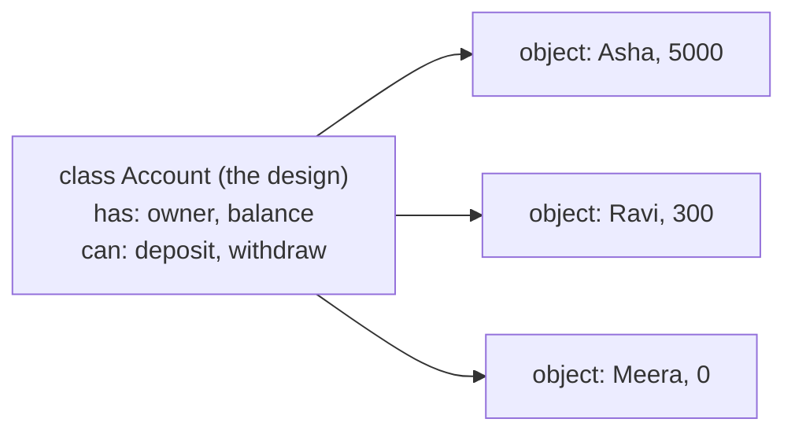
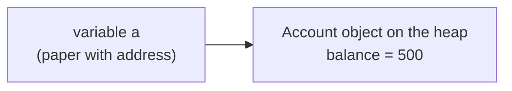
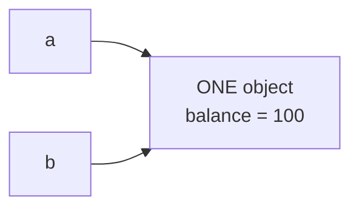
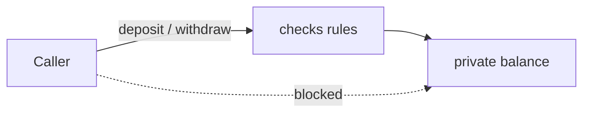
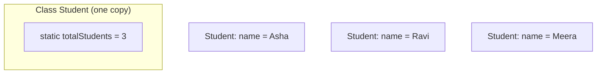

# Day 1 Beginner Lesson (Java): Classes, Objects, Constructors, Static, Encapsulation

Read this top to bottom. Do each "Try it" before moving on. You need a JDK installed (check: `java -version`). Every concept is explained from zero.

---

## Step 1. The problem objects solve

Imagine you write a banking program with plain variables:

```java
String ownerName1 = "Asha";   long balance1 = 5000;
String ownerName2 = "Ravi";   long balance2 = 300;
```
For 1,000 customers you would need 2,000 loose variables, and nothing links an owner to their balance. An **object** bundles related data *and* the actions on that data into one unit. Think of a **bank card**: it holds your details, and you can do things with it (pay, check balance).

- **Class** = the *design* (a blank form, a cookie cutter).
- **Object** = one *real thing* made from the design (a filled-in form, one cookie).



---

## Step 2. Your first class, every word explained

```java
public class Account {
    private long balance;          // data (called a FIELD)

    public void deposit(long amount) {   // action (called a METHOD)
        balance = balance + amount;
    }

    public long getBalance() {
        return balance;
    }
}
```
Word by word:
- `class Account` : "I am defining a new type called Account."
- `public` : anyone can use this. `private` : only code inside this class can use it.
- `long` : a whole-number type (big). We store money as whole numbers of paise to avoid decimal errors (0.1 + 0.2 is not exactly 0.3 in computers).
- `void` : "this method gives nothing back". `long getBalance()` : "this method gives back a long".
- `balance` is a **field**: a variable that lives inside each object.
- `deposit` and `getBalance` are **methods**: actions an object can do.

**Try it:** create `Day1.java`:
```java
public class Day1 {
    public static void main(String[] args) {
        Account a = new Account();
        a.deposit(500);
        System.out.println(a.getBalance());   // prints 500
    }
}
class Account {
    private long balance;
    public void deposit(long amount) { balance = balance + amount; }
    public long getBalance() { return balance; }
}
```
Run: `java Day1.java`. (`main` is where Java starts running. `System.out.println` prints a line.)

---

## Step 3. What `new` does, and what a variable really holds

`Account a = new Account();` does four things:
1. Finds room in memory (the **heap**, a big shared area) for one Account.
2. Sets its fields to defaults (numbers become 0, text becomes `null` meaning "nothing").
3. Runs the **constructor** (Step 5).
4. Hands back a **reference**: an *address* telling you where the object lives. `a` stores that address, not the object.

Think: the object is a **house**; the variable `a` is a **piece of paper with the house's address**.



Now the key interview idea:
```java
Account a = new Account();
Account b = a;       // copies the PAPER (address), not the house
b.deposit(100);
// a.getBalance() is also changed. Same house!
```

To get a truly separate account you must write `new Account()` again.

`==` on two objects asks "same house (same address)?" not "same contents?". For contents, classes provide `equals` (Step 9).

**Try it:** `Ex4_References.java` in this folder tests exactly this. Predict first, then run.

---

## Step 4. Why `private`? The bug story

If `balance` were `public`, any code anywhere could do:
```java
a.balance = -999999;   // nonsense, and nothing stops it
```
Making the field `private` and giving controlled methods means *only* `deposit`/`withdraw` can change money, and they can check the rules:

```java
public void withdraw(long amount) {
    if (amount <= 0) throw new IllegalArgumentException("amount must be positive");
    if (amount > balance) throw new IllegalStateException("insufficient funds");
    balance = balance - amount;
}
```
`throw` stops the method with an error so bad actions never happen. This idea is called **encapsulation**: hide the data, expose safe actions.

A **rule that must always be true** about an object is called an **invariant**. For an Account: "balance is never negative". Encapsulation exists to protect invariants. If you remember one sentence from today: *"Encapsulation protects invariants by making sure only the class's own methods can change its data."*

Warning for interviews: adding a getter AND setter for every private field (`setBalance(-5)`) is *not* encapsulation; it is a public field in disguise. Offer actions (`withdraw`), not raw setters.



---

## Step 5. Constructors: starting life valid

A **constructor** is a special method that runs once when an object is created. It has the class's name and no return type. Its job: make the new object valid from the first moment.

```java
public Account(long openingBalance) {
    if (openingBalance < 0) throw new IllegalArgumentException("negative opening balance");
    this.balance = openingBalance;
}
```
- `this` means "the object being worked on right now". `this.balance` is the object's field; `openingBalance` is the input. When names clash (`balance` field vs `balance` input), `this.` tells Java which you mean.
- Now `new Account(500)` works and `new Account(-5)` fails immediately, so a broken Account can never exist.
- If you write *no* constructor, Java gives a free empty one. The moment you write one, the free one disappears.
- You can have several constructors with different inputs. That is **overloading**.

---

## Step 6. `static` vs instance (the school analogy)

In a school, every student has their *own* name and marks (**instance**: one per object). But the school has *one* name shared by everybody (**static**: one per class).

```java
class Student {
    private String name;                 // each Student has their own
    private static int totalStudents = 0; // ONE shared by the whole class

    Student(String name) { this.name = name; totalStudents++; }
    static int getTotalStudents() { return totalStudents; }
}
```
- A `static` method belongs to the class, so there is no "current student" (`this` does not exist). That is why it *cannot* read `name`: which student's name?
- Call it as `Student.getTotalStudents()`, no object needed.



**Interview trap:** if many threads (things running at once) create students together, `totalStudents++` can lose counts, because "read, add 1, write" is three steps and threads can interleave. A static variable is shared and changeable, so it is risky. The fix is `AtomicInteger`. We go deep in the concurrency weeks. **Try it:** `Ex0_StaticCounter.java` shows the bug happening.

---

## Step 7. Immutable objects (the safest kind)

An object that can never change after creation is **immutable**. Nothing can break it, and many threads can share it safely.
```java
record Point(int x, int y) { }   // Java builds constructor, getters, equals, hashCode for you
```
Use immutability by default; add mutation only when needed.

---

## Step 8. Money rule: never `double`

`0.1 + 0.2` gives `0.30000000000000004`. For money use whole minor units (`long` paise) or `BigDecimal`.

---

## Step 9. `equals` and `hashCode` (a classic trap)

A `HashMap` finds items by turning a key into a number (`hashCode`), jumping to a bucket, then checking `equals`. Two rules: if you override `equals`, override `hashCode` too; and don't use a key you later mutate, because its hash changes and the map can no longer find it. **Try it:** `Ex5_EqualsHashCode.java`.

---

## Step 10. Check yourself (answer aloud, then compare)

1. What is the difference between a class and an object?
   *Model:* a class is the design; an object is one real instance built from it with its own data.
2. What happens when you write `new Account(100)`?
   *Model:* memory is allocated on the heap, fields get defaults, the constructor runs, and a reference to the object is returned.
3. If `Account b = a;`, how many objects exist? What happens if you change one through `b`?
   *Model:* one object, two references; the change is visible through both.
4. Why make fields private?
   *Model:* to protect invariants; only the class's methods can modify state, so they can enforce the rules.
5. Static vs instance?
   *Model:* instance is one copy per object; static is one copy for the class, with no `this`, and shared mutable static state is a thread-safety risk.
6. Is Java pass-by-value or pass-by-reference?
   *Model:* always pass-by-value; for objects the value passed is the reference, so a method can change the object but cannot repoint your variable.

**Production-style question (SWE-2 flavor):** "A bug report says some accounts show negative balances. What in the class design would you check first, and what layer besides Java code would also protect against it?" *(Hint: public fields or setters, missing validation in constructors, race conditions, and a database `CHECK (balance >= 0)` constraint.)*

---

## Your order of work today
1. Read Steps 1 to 4. Do the Step 2 "Try it".
2. Read Steps 5 to 6. Do `Ex0_StaticCounter.java` and `Ex4_References.java`.
3. Read Steps 7 to 9. Do `Ex5_EqualsHashCode.java`.
4. Then the bigger exercises: `Ex1`, `Ex2`, `Ex3`, `Ex6`, and the LLD file.
5. Say the Step 10 answers aloud without notes.

Stuck on any step? Tell me which step number and what you expected versus what happened.
