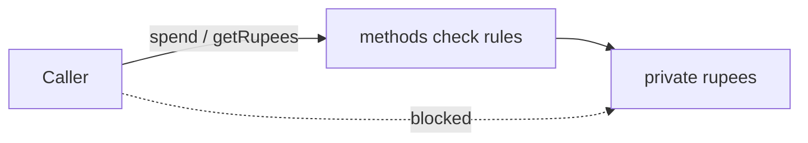
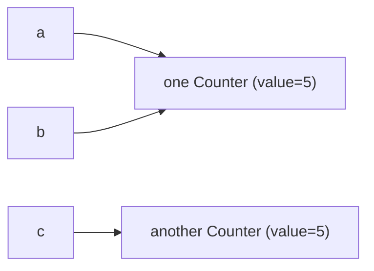
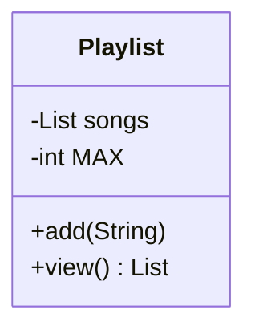

# Day 1 / 56 — Classes, Objects, Encapsulation, Invariants

**Date:** 2026-11-24 | **Week 1: OOP Foundations** | Time (PLAN.md, Weeks 1-4): DSA 20 · Core 75 · LLD 55 · OSS 15 · Career 15 = 180 min

**How today works:** for each topic you first **see a working example and its real output**, then answer a small number of questions based on it. Required work is marked **YOUR TURN**; everything else is optional.

**After today you can:** explain a class, object, constructor and `static` from scratch; explain why `private` data protects rules (invariants); predict what happens when two variables point to one object; write a small class that rejects invalid input.

**Prerequisites:** JDK 17+ (`java -version`), a g++ compiler, git. Previous day: none.

---

## B. DSA — 20 min: Two Sum — **done**
Your hash-map solution was reviewed. **YOUR TURN (5 min):** open [two_sum.cpp](../dsa/day-01/two_sum.cpp). It looks like the LeetCode editor: the problem statement, then `class Solution` with the exact signature. Paste your solution inside the class, apply the review notes (loop from 0, single lookup, earlier index first), and run it; the verdicts read "Accepted" or "Wrong Answer" ([README](../dsa/day-01/README.md)). When it passes, submit the same class on LeetCode. Then answer the 3 follow-ups written at the bottom of that file. Remaining time: read tomorrow's DSA topic, no new problem today.

---

## C. Core SWE (Java) — 75 min

**Read first:** [beginner lesson, steps 1-10](../core-swe/day-01/LESSON.md). It explains everything below in plain language.

### Part 1 — See it work (25 min). Run each file and read the output.

**Example 1: a class protecting its rule** — [Example1_EncapsulationWorks.java](../core-swe/day-01/examples/Example1_EncapsulationWorks.java)
```
$ java Example1_EncapsulationWorks.java
after spending 30: 70
spend 500 rejected: not enough money
still: 70 (a failed call changed nothing)
bad wallet never created: opening must be >= 0
```
What to notice: the rule "money is never negative" lives in *one place* (the methods). The field is `private`, so nobody can bypass it. A failed call leaves the object unchanged.



**Example 2: variables hold addresses** — [Example2_References.java](../core-swe/day-01/examples/Example2_References.java)
```
a.value = 5 (changed through b)
a == b: true
a == c: false (different objects, even with same contents)
after addOne(a): 6
after swapInside(a): 6 (the caller's variable was not repointed)
```
What to notice: `b = a` copies the *address*, so there is one object and two names. `==` compares addresses. A method can change the object it receives but cannot repoint your variable (pass-by-value of the reference).



**Example 3: `static` is shared, and sharing is risky** — [Example3_StaticAndRace.java](../core-swe/day-01/examples/Example3_StaticAndRace.java)
Run it a few times. The `AtomicInteger` count is always exactly right; the plain `int` count is usually too low when two threads update it (lost updates). Static = one copy for the whole class, so it is shared mutable state.

**Watch (optional, 10 min):** [Stack vs Heap in Java Explained Visually](https://www.youtube.com/watch?v=frOT6yXG0j0) (found via search, not reviewed in full).

### Part 2 — YOUR TURN (35 min). Three coding questions, each modeled on an example above.

| # | Question | Based on | File |
|---|---|---|---|
| 1 | Fix the counter so the two-thread test reaches exactly 200000. Why was it wrong? | Example 3 | [Ex0_StaticCounter.java](../core-swe/day-01/Ex0_StaticCounter.java) |
| 2 | Add `transfer(to, amount)` to Account. Self-transfer rejected; any failure leaves both balances unchanged. | Example 1 | [Ex1_AccountTransfer.java](../core-swe/day-01/Ex1_AccountTransfer.java) |
| 3 | Make `MutablePoint` a safe HashMap key, then see why mutating a key loses the entry. | Example 2 and LESSON step 9 | [Ex5_EqualsHashCode.java](../core-swe/day-01/Ex5_EqualsHashCode.java) |

Run each with `java <file>`; exit code 0 means all tests pass. Write the one- or two-sentence WRITTEN ANSWER at the bottom of each file.

**Optional extra practice (only if you have time):** [Ex2 DateRange](../core-swe/day-01/Ex2_DateRange.java) · [Ex3 Temperature](../core-swe/day-01/Ex3_Temperature.java) · [Ex4 predict the output](../core-swe/day-01/Ex4_References.java) · [Ex6 Library](../core-swe/day-01/Ex6_Library.java). See the [README](../core-swe/day-01/README.md).

### Part 3 — Interview questions (15 min). Answer aloud, then compare with LESSON step 10.
1. Class vs object? What does `new` do?
2. `Account b = a;`: how many objects? Is Java pass-by-value or by reference?
3. Why `private`? Why are "getter and setter for everything" not real encapsulation?
4. Static vs instance? Why can't a static method read an instance field?
5. Production question: "Some accounts show negative balances. What do you check in the class, and what else besides Java code protects against it?" (Hint: public setters, missing validation, races, a database `CHECK` constraint.)

---

## D. LLD (Java) — 55 min: model a small thing with rules

### Part 1 — See it work (15 min)
**Worked example: Playlist** — [Example4_Playlist.java](../lld/day-01/examples/Example4_Playlist.java). Rules: no duplicate songs, max 3 songs, callers cannot sneak around the rules.
```
$ java Example4_Playlist.java
songs: [A, B, C]
rejected: playlist full
cannot bypass rules through the view
final: [A, B, C]
```
What to notice: (1) the list is `private`; (2) every rule is checked in `add`, before changing anything; (3) `view()` returns a read-only list so the rule cannot be bypassed; (4) a rejected call changes nothing.



### Part 2 — YOUR TURN (30 min): same pattern, money domain
Fill in [LldDay01.java](../lld/day-01/LldDay01.java): `Money` (immutable, same-currency only), `Account` (balance never negative), and `transfer` (all-or-nothing). Eight tests are already written. Run: `java lld/day-01/LldDay01.java`. Then write 5 sentences at the bottom: which rule belongs to `Money` and which to `Account`, and how you would handle two threads transferring at once (describe only).

**Why it is shaped this way:** `Money` as its own class keeps currency and overflow rules in one place, so `Account` stays small. This is the foundation for the full bank ledger LLD on Day 50.

### Part 3 — Optional (10 min, paper only)
- **Cart drill:** from the sentence in the LLD file, list classes, fields and rules before coding.
- **PrepTrack:** why should a task definition and a task-completion record be separate? What happens if a task is completed twice?

---

## E. Open Source — 15 min (light today)
Open two repositories you might contribute to (for example one Java or Python backend project and one cloud or AI infrastructure project). For each, read the README and CONTRIBUTING file and write 3 lines in [open-source/shortlist.md](../open-source/shortlist.md): what it does, how to run its tests, whether it has a "good first issue" label. No PR today. I have not verified any issues; we check live data before choosing one.

## F. Career — 15 min
Write 2 project bullets from real work (action verb + what you built + scale + technology + measurable outcome; use only real numbers) in `career/day-01/bullets.md`. Then write a 60-second introduction: who you are, two systems you built, your strengths, what you want next. Say it aloud once.

---

## H. Interview vocabulary: say it the way interviewers expect

Use these exact terms in answers. Format: **term**: how to say it in one sentence.

- **Encapsulation**: "Bundling state with the methods that operate on it and restricting direct access, so the class can enforce its invariants."
- **Invariant**: "A condition that must hold for every valid object whenever it is visible to callers; the constructor establishes it and every public method preserves it."
- **Abstraction vs encapsulation**: abstraction exposes *what* an object does and hides complexity; encapsulation protects *how* state changes. Different ideas, often confused.
- **Reference semantics / pass-by-value of the reference**: "Java always passes by value; for objects the value is the reference, so a method can mutate the object but cannot repoint the caller's variable."
- **Heap vs stack**: objects live on the heap and are garbage collected; local variables and references live on the thread's stack.
- **Identity vs equality**: `==` compares references; `equals` compares logical content. "If you override `equals` you must override `hashCode`; equal objects must have equal hash codes."
- **Immutability / value object**: "Its state cannot change after construction, so it is inherently thread-safe and safe as a map key."
- **Defensive copy / unmodifiable view**: "Don't leak internal mutable state; return a copy or read-only view."
- **Fail-fast / validate at the boundary**: "Reject invalid input in the constructor or method entry so an invalid object never exists."
- **Strong exception guarantee**: "If an operation fails, state is unchanged: validate first, mutate last."
- **Race condition / atomicity**: "`count++` is read-modify-write, not atomic; two threads can interleave and lose an update. Use `AtomicInteger` or a lock."
- **Shared mutable state**: "The root cause of most concurrency bugs; `static` mutable fields are shared by all threads."
- **Two layers of defence**: "Enforce invariants in the domain class and again in the database with `CHECK`/`NOT NULL`/foreign keys, since other writers may exist."
- **Minor units**: "Store money as integer minor units or `BigDecimal`, never `float`/`double`, to avoid rounding error."

**Practice (3 min):** pick 5 terms and say each aloud in your own words with an example. If you cannot, reread the matching LESSON step.

---

## G. End-of-day checklist
- [ ] Two Sum saved and tests pass in `two_sum.cpp`
- [ ] Examples 1-4 run and read
- [ ] Core Ex0, Ex1, Ex5 pass with written answers
- [ ] `LldDay01.java` tests pass
- [ ] Interview questions answered aloud
- [ ] OSS shortlist notes · bullets and pitch written

**Self-assessment (1-5):** can I explain a class, an object and a reference to a friend? Can I say what an invariant is and where it is enforced? Can I predict output when two variables share an object?

**Progress log:** time per track, what confused you (which step), test output, commit hashes.

**Tomorrow (Day 2):** constructors in depth, object lifecycle, `final`, `equals`/`hashCode`, `try-with-resources`; DSA: one medium stack problem. Same format: worked examples first, then your turn.
