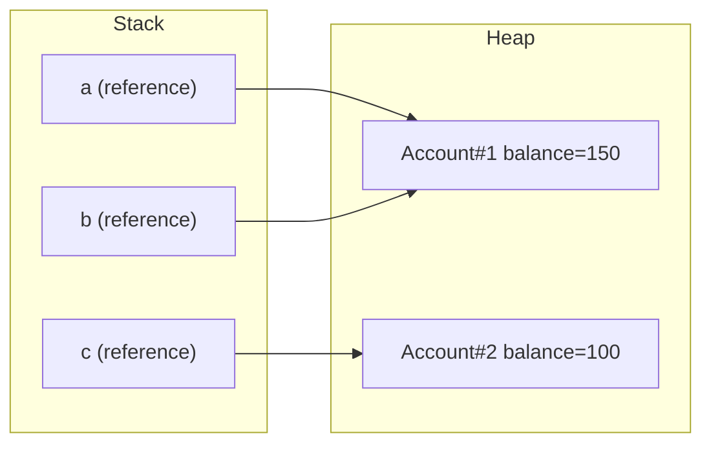
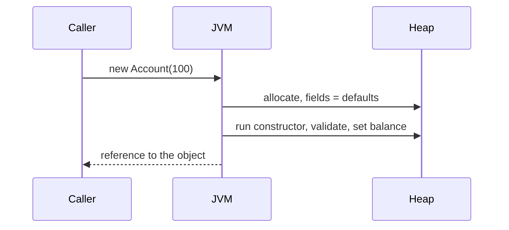
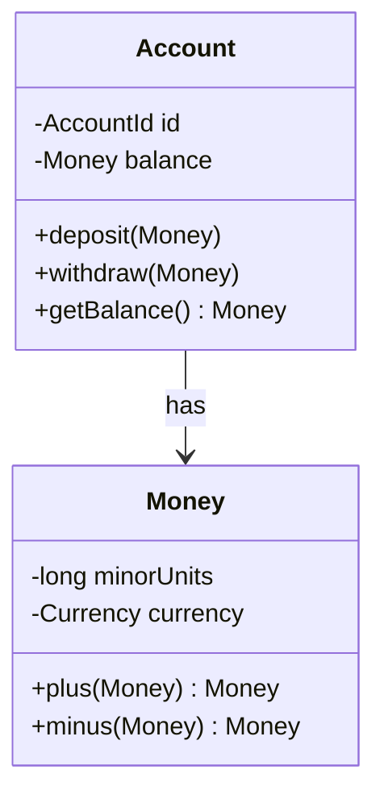

# Day 1 / 56 — Classes, Objects, Encapsulation, Invariants

**Date:** 2026-11-24 (IST) | **Week 1: OOP Foundations**

## A. Overview

**Objective:** Understand a class as a *guardian of invariants*, not a bag of fields.

**After today you can:**
- Define "invariant" and name the invariants of a class you write.
- Explain why `public` data members break encapsulation (with a concrete bug).
- Write a Java class with a private representation, validated constructor, and a minimal public interface.
- Solve Two Sum in C++ and explain the hash-map trade-off.

**Prerequisites:** Basic C++ (DSA) and Java 17+ (OOP) syntax, a JDK installed, git, a GitHub account.
**Previous-day recap:** None (Day 1).

Time budget (Weeks 1-4 split, see PLAN.md): DSA 20 · Core 75 · LLD/HLD 55 · OSS 15 · Career 15 = **180 min**. AI and project tracks start in Week 5.

---

## B. DSA — 20 min: LeetCode 1, Two Sum (Easy)

**Status: done.** Solution submitted and reviewed (hash map, O(n) average). Remaining 5-min cleanup: apply the review notes (loop from 0, single lookup, `{it->second, i}`) and answer the three follow-ups below. From Day 2, DSA problems are medium/hard.

**Problem:** Given `vector<int> nums` and `int target`, return indices of the two numbers that add to `target`. Exactly one solution exists; you may not use the same element twice.
**Constraints:** 2 ≤ n ≤ 10⁴, −10⁹ ≤ nums[i], target ≤ 10⁹.

**Intuition:** For each `x`, you need `target - x` somewhere else. Searching for it is the whole problem.

**Hints (open one at a time):**
1. Brute force: all pairs. What is the cost?
2. What data structure answers "have I seen value v, and where?" in O(1) average?
3. Can you check *before* inserting the current element? Why does that handle the "same element twice" rule and duplicates like `[3,3], 6`?
4. Overflow: can `target - x` overflow `int` under these constraints? (Think about the range.)

**Approaches:**
- Brute force: O(n²) time, O(1) space.
- Sort + two pointers: O(n log n), but you lose original indices (must carry them) — O(n) space.
- Hash map one pass: O(n) average time, O(n) space. Worst-case hash collisions degrade; mention it.

**Workspace (fill in and run):** [dsa/day-01/two_sum.cpp](../dsa/day-01/two_sum.cpp), see [README](../dsa/day-01/README.md) for the run command.

**Your task:** implement `vector<int> twoSum(vector<int>& nums, int target)` in C++17 in `dsa/day-01/two_sum.cpp`, with a `main` that asserts the tests below.

**Test requirements:** `[2,7,11,15],9→[0,1]` · `[3,2,4],6→[1,2]` · `[3,3],6→[0,1]` · negatives `[-1,-2,-3,-4,-5],-8→[2,4]` · `[0,4,3,0],0→[0,3]`.
Follow-ups to answer: What changes if multiple answers exist? If the array is sorted? If it doesn't fit in memory?

*Solution withheld. Submit yours and I'll review correctness, complexity, edge cases, style.*

---

## C. Core SWE (OOP in Java) — 75 min: Classes, Encapsulation, Invariants

### 0. Starting from zero: the building blocks (read first, ~10 min)

**Class vs object.** A class is a blueprint (a type); an object is one concrete thing built from it. `Account` is the class; "account #101" is an object. Each object has its own copy of its instance data.

**What `new` does (conceptual JVM model).** `Account a = new Account(100);`
1. Memory for the object is allocated (typically on the heap).
2. Fields get default values (0, null, false).
3. The constructor runs.
4. A **reference** to the object is returned and stored in `a`.

```java
Account a = new Account(100);
Account b = a;          // copies the REFERENCE: a and b are the same object
b.deposit(50);          // visible through a too
Account c = new Account(100);  // a different object
a == c;                 // false: == compares references; equals() compares content (if overridden)
```
Java variables of class type are references; objects are never copied implicitly. (In C++ `Account c = a;` copies the object; interviewers like this contrast.) Java passes references **by value**: a method can mutate the object it receives, but cannot repoint your variable.

**Constructors.** Same name as the class, no return type, run once at creation to set the object up. If you declare none, Java supplies a default no-arg constructor; declare any, and the default disappears. Constructors can be overloaded and can chain with `this(...)` (must be the first statement). They are not inherited. Make sure no constructor leaves an object half-valid.

**`this`.** The current object. `this.balance = balance;` distinguishes the field from the parameter.

**Instance vs static members.**
```java
public class Employee {
    private static int count = 0;      // one per CLASS
    private final String name;         // one per OBJECT

    public Employee(String name) {
        this.name = Objects.requireNonNull(name);
        count++;                       // NOT thread-safe!
    }
    public static int getCount() { return count; }   // no 'this': cannot read 'name'
}
```
A static method has no `this`, so it can't touch instance fields without an object passed in.

**Interview trap: static is shared mutable state.** 100 threads constructing `Employee` race on `count++` (read-modify-write, not atomic), causing lost updates. Fix with `AtomicInteger`. "Static" never means "thread-safe". (Full treatment in Week 3.)

**Practice (10 min):** write `Employee`, create three objects, print `getCount()`; then try to read `name` inside `getCount()` and read the compiler error. Create two threads that each construct 100,000 employees and see whether the count is 200,000.

**Diagram: references vs objects (what `b = a` really does)**


**Diagram: object lifecycle of `new Account(100)`**


**Watch (optional, 10 min):** Java memory model basics, stack vs heap and references. [Stack vs Heap in Java Explained Visually](https://www.youtube.com/watch?v=frOT6yXG0j0) (found via search; check it matches the lesson).

### 1. Definitions
- **Class:** a user-defined type bundling *state* (fields) and *behavior* (methods).
- **Object:** an instance of a class with identity, state and behavior.
- **Encapsulation:** hiding the representation behind an interface so only the class's own code can change state.
- **Invariant:** a condition that must hold for every valid object whenever it is observable from outside (after construction and around every public method).

Encapsulation is the *mechanism*; invariants are the *reason*.

### 2. Why it exists
If any code can write any field, correctness depends on every caller. With encapsulation, correctness depends on a few methods. Bugs are localized and you can change representation without breaking callers.

### 3. Internal working in Java
- Access modifiers: `private` (class only), package-private (default), `protected` (package + subclasses), `public`. They are compile-time checks (reflection can bypass them, so they protect against mistakes, not malice).
- Instance methods receive a hidden `this`. `final` fields must be assigned exactly once by the end of the constructor and give you safe-publication guarantees under the Java Memory Model (preview, Week 3).
- Constructors establish the invariant or **throw**. Never let `this` escape from a constructor (e.g., registering it as a listener) before construction finishes; other threads or callbacks can see a half-built object.
- Object identity (`==`) vs equality (`equals`/`hashCode`): if you override one you must override the other. Mutable fields used in `hashCode` break `HashMap` lookups.
- Immutability is the strongest form of encapsulation: `final` class, `private final` fields, no setters, defensive copies of mutable inputs/outputs. Java `record` gives this for simple values.

### 4. Example: broken vs. protected

```java
// BAD: no invariant enforcement
class BadAccount { public long balance; }
BadAccount a = new BadAccount();
a.balance = -5000;                 // legal, nonsense

// GOOD
public final class Account {
    // INVARIANT: balance >= 0 (minor units, e.g. paise)
    private long balance;

    public Account(long openingPaise) {
        if (openingPaise < 0) throw new IllegalArgumentException("negative opening balance");
        this.balance = openingPaise;
    }

    public long getBalance() { return balance; }

    public void deposit(long paise) {
        if (paise <= 0) throw new IllegalArgumentException("deposit must be positive");
        this.balance = Math.addExact(balance, paise);      // throws on overflow
    }

    public void withdraw(long paise) {
        if (paise <= 0) throw new IllegalArgumentException("withdraw must be positive");
        if (paise > balance) throw new IllegalStateException("insufficient funds");
        this.balance -= paise;
    }
}
```
Observations: money is integer minor units (never `double`); validation comes first and mutation last, so a failed call leaves state unchanged (**strong exception guarantee**); `Math.addExact` protects the invariant against overflow.

### 5. Backend relevance
- DB analog: `CHECK (balance >= 0)`, `NOT NULL`, foreign keys are invariants at the storage layer. App classes and DB constraints are **two layers of defence**; the DB is the last because many services may write.
- Spring entities and DDD aggregates: the aggregate root enforces invariants ("order total = sum of lines"). Anemic entities with public setters push that logic into scattered services.
- Concurrency: an invariant spanning two fields is only safe if updates are atomic (Week 3). `private` is not thread-safe.

### 6. Common mistakes / misconceptions
1. **Getter and setter for every field** = public fields with extra typing. Expose behavior (`withdraw`), not state (`setBalance`).
2. Returning a mutable internal object (`List`, `Date`, array) from a getter lets callers break invariants. Return an unmodifiable view or a copy (`List.copyOf`).
3. Validating in setters but not the constructor (or vice versa).
4. Believing `private` means thread-safe.
5. Invariants documented nowhere. Write them as a comment on the fields and as tests.
6. Using `double` for money. Use `long` minor units or `BigDecimal` with an explicit scale.
7. Confusing class invariant with precondition (caller's obligation) and postcondition (callee's promise).
8. Thinking Java is pass-by-reference. It is pass-by-value of the reference.

### 7. When useful / not
- Use a class with private state when an invariant links multiple fields or the representation may change.
- A plain `record` or simple data holder is right for DTOs and config. Don't add ceremony.

### 8. Exercises (do in `core-swe/day-01/`, Java 17+)
1. Add `transfer(Account to, long amount)`. Which invariants matter? What if `to == this`? What if the deposit throws after the withdraw succeeded? Fix it.
2. Write `DateRange` with invariant `start <= end`. Make it immutable (`record` with a compact constructor check). Implement `contains` and `overlaps`. What does immutability buy you?
3. Write `Temperature` storing Kelvin privately, with `fromCelsius`/`toCelsius`. Show you could change the internals without touching callers.
4. Demonstrate reference semantics: write a method `void reset(Account a)` that sets `a = null` and another that calls `a.deposit(1)`. Predict, then run, and explain what the caller observes.

5. `equals`/`hashCode`: write a mutable `Point` class, use it as a `HashMap` key, mutate it, and show the lookup failing. Then make `Point` an immutable `record` and repeat.
6. Mini-build (25 min): `Library` with `Book` and `Member`. Invariants: a book is borrowed by at most one member; a member holds at most 3 books. Decide what is public, what is immutable, and how to prevent the caller from mutating internal lists. Write 6 tests including the failure paths.
7. Verbal drill (5 min): explain class vs object, constructors, `new`, static vs instance and pass-by-value-of-reference in 3 minutes without notes. Record yourself.

**Workspace (fill in and run; tests and written answers inside each file):** [README with run commands](../core-swe/day-01/README.md)
[Ex0 static counter](../core-swe/day-01/Ex0_StaticCounter.java) · [Ex1 transfer](../core-swe/day-01/Ex1_AccountTransfer.java) · [Ex2 DateRange](../core-swe/day-01/Ex2_DateRange.java) · [Ex3 Temperature](../core-swe/day-01/Ex3_Temperature.java) · [Ex4 references](../core-swe/day-01/Ex4_References.java) · [Ex5 equals/hashCode](../core-swe/day-01/Ex5_EqualsHashCode.java) · [Ex6 Library](../core-swe/day-01/Ex6_Library.java)

### 9. Interview questions
- What is encapsulation, and how does it differ from abstraction?
- What is a class invariant? Where is it established and preserved?
- Why are getters/setters not automatically encapsulation?
- Class vs object? What happens when you use `new`?
- Static vs instance members? Why can't a static method read an instance field?
- `==` vs `equals()`? Why override `hashCode` with `equals`?
- Is Java pass-by-value or pass-by-reference?
- Why is a `private` getter returning a `List` field still a leak?
- How would you enforce the same invariant in app code and PostgreSQL?

**Follow-ups:** Can an invariant be temporarily broken? (Inside a method, yes; restored before returning or the exception escapes, hence the strong guarantee.) How do invariants interact with inheritance? (Preview Day 6, LSP.) How does multithreading change this?

---

## D. LLD (Java) — 55 min: Design `Money` and `Account` (foundation for Day 50)

**Scope today:** classes, invariants, interface. No inheritance, no patterns, no persistence yet.

**Functional:** open account with initial deposit; deposit; withdraw; get balance; transfer between two accounts.
**Non-functional:** no negative balances, no precision loss, failed operations leave no partial effect, testable without a DB or clock.

**Entities:**
```
Money      — immutable value type: long minorUnits + Currency. Same-currency arithmetic only.
AccountId  — strong type wrapping a String (prevents mixing ids with amounts).
Account    — id, balance (Money). Invariant: balance >= 0, currency fixed for life.
```
**Class diagram:**


**Textual UML:**
```
+-----------+ 1     1 +---------+
| Account   |-------->| Money   |
| -id       |         | -minor  |
| -balance  |         | -ccy    |
| +deposit  |         | +plus   |
| +withdraw |         | +minus  |
+-----------+         +---------+
```
**Your task (write in `lld/day-01/`, Java 17+, JUnit 5 or plain asserts):**
1. Implement `Money` as an immutable class or `record` (`plus`, `minus` throw on currency mismatch/overflow; `compareTo`).
2. Implement `Account` using `Money`.
3. Write `transfer` as a member or a separate service, and justify the choice. A failed transfer must leave both balances unchanged.
4. Write 8 tests: invalid construction, withdraw exactly the balance, overdraft, currency mismatch, self-transfer, overflow, failed transfer leaves both balances unchanged, a mutation through a getter is impossible.
5. Write 5 sentences: which invariants live in `Money` vs `Account`, and how you would handle concurrency (describe only; Week 3 implements it).

**Warm-up design (10 min, paper only): "PrepTrack", a study tracker.** Entities: User, StudyTask, StudySession, Progress. Answer in writing:
1. Is a task *definition* ("Solve Two Sum") the same thing as a *completion record* (who did it, when, how long)? Why should they be separate?
2. What happens if a user completes the same task twice? (Idempotency preview.)
3. Draft three endpoints: `GET /api/v1/study-sessions/today`, `POST /api/v1/tasks/{id}/complete`, `GET /api/v1/progress` (paginated). Note auth, the already-completed case, and what each returns.
Deliver: 4 entities x 5 fields, 2 relationships, 1 design issue you spotted.

**Workspace (fill in and run):** [lld/day-01/LldDay01.java](../lld/day-01/LldDay01.java) holds Money, Account, transfer, the Cart drill, 8 tests and written answers. Run: `java lld/day-01/LldDay01.java`.

**Requirements-to-classes drill (15 min):** take this statement and extract the classes, fields and methods yourself (nouns -> classes/fields, verbs -> methods), then list the invariants: "A shopping cart holds items with quantities. A user can add or remove items, apply one coupon, and check out. Quantity must be positive; the total cannot be negative; an empty cart cannot be checked out." Write the class list and invariants first, then code `Cart` and `CartItem` using your `Money`. Note one thing you would deliberately leave out today (e.g. payments, inventory).

**Think about (don't build yet):** DB schema `accounts(id, balance_minor BIGINT CHECK (balance_minor >= 0), currency CHAR(3), version INT)`; append-only ledger for audit; idempotency key for transfers; metrics on failed withdrawals.

---

## E. Open Source — 15 min

**Task:** Build a shortlist; do not contribute yet.
1. Pick 5 candidate repos in your areas (e.g., Python: FastAPI, Pydantic; AI infra: LangChain/LlamaIndex/vLLM; cloud-native: Kubernetes ecosystem/Prometheus; C++: well-maintained libs such as fmt or abseil).
2. For each, record in `open-source/shortlist.md`: language, last commit date, open-issue count, whether `CONTRIBUTING.md` and "good first issue" labels exist, review responsiveness (look at recent PR time-to-first-review).
3. I have **not** verified any specific issues today. When we reach issue selection, we'll check live data via `gh issue list --label "good first issue"` before choosing anything.

---

## F. Career — 15 min

**Task:** Write a **project bullet audit**. Take your two strongest projects from Akatsuki and write each as:
`Action verb + what you built + scale/constraint + technology + measurable outcome`.
Example shape: "Built X using Kafka and Postgres handling N events/day, cutting Y by Z%." Use only real numbers; if you lack one, note how to measure it. Save as `career/day-01/bullets.md`. Also draft (don't send) a 60-second "tell me about yourself" using this frame, in your own words: who you are → the work you do (two real systems) → your technical strengths → problems you enjoy → what you're looking for. Name three strengths and one project you can explain end-to-end. Speak it aloud once and time it.

---

## G. End-of-day checklist

**Tasks:** Two Sum (done) · Core exercises 1-7 · Money+Account LLD with 8 tests · requirements-to-classes drill (Cart) · PrepTrack paper design · OSS shortlist · resume bullets and 60-second pitch.

**Deliverables (commit to repo):** `dsa/day-01/two_sum.cpp`, `core-swe/day-01/*.java`, `lld/day-01/*`, `open-source/shortlist.md`, `career/day-01/bullets.md`.

**You should be able to answer:**
1. Define invariant; state the invariants of `Account`.
2. Why do setters not equal encapsulation?
3. Two Sum: complexity, and why one-pass insertion order matters.
4. Why integer minor units for money? What does Java pass: value or reference?

**Self-assessment (1–5):** Can I explain invariants without notes? Can I write the class without looking? Did I test failure paths? Did I understand the hash-map trade-off?

**Progress log:** time spent per track, what was hard, what you got stuck on, test output evidence, commit hashes, open questions.

**Tomorrow (Day 2):** Constructors, initialization, object lifecycle, copying vs references (Java counterpart of RAII/copy semantics). Expect DSA: medium stack problem (e.g. Daily Temperatures or Min Stack), and Java object lifecycle: constructors, initialization order, `final`, `try-with-resources`/`AutoCloseable`, `equals`/`hashCode`, plus a resource-owning class to implement.
